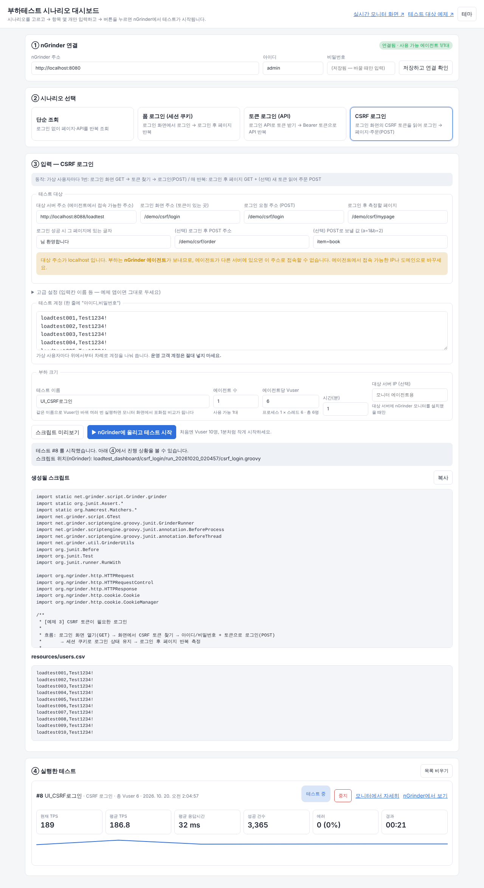

# 부하테스트 시나리오 대시보드 (WAS 배포용)

WAS에 WAR 파일 하나만 올리면 아래 세 가지가 함께 들어갑니다.

| 주소 (배포 후) | 내용 |
|---|---|
| `http://WAS주소:포트/loadtest/` | **시나리오 대시보드** — 시나리오 선택 → 항목 몇 개 입력 → 테스트 종류(단위·통합·성능·임계) 선택 → 버튼 클릭 → 결과·판정 확인 |
| `http://WAS주소:포트/loadtest/intro.html` | **성능테스트 개론** — 테스트 종류, 지표, 공식(실측값 검산), 진행 순서, 결과 해석 |
| `http://WAS주소:포트/loadtest/monitor/` | **실시간 모니터** — 기존 `ngrinder-dashboard` 화면 (TPS·응답시간·포화점·에이전트) |
| `http://WAS주소:포트/loadtest/demo/` | **부하테스트 대상 예제 기능** — 조회 / 폼 로그인 / 토큰 로그인 API / CSRF 로그인. 실제 서비스 없이도 바로 부하테스트를 해볼 수 있음 |

## 테스트 종류 (권장 순서 1 → 4)
| # | 종류 | 하는 일 | 실행 주체 · 시간 | 판정 |
|---|---|---|---|---|
| 1 | **단위테스트** | 시나리오의 요청을 **1건씩** 보내 단계마다 응답코드·응답시간·성공 글자·토큰 확인 | 이 WAS가 직접 · 몇 초 | 단계별 통과/실패 + 실패 원인 |
| 2 | **통합테스트** | 실제 nGrinder 에이전트에서 가상 사용자 1명이 시나리오를 N회 실행 (연결·스크립트·계정 전체 확인) | nGrinder · 1분 이내 | 에러 0건이면 통과. 실패하면 **에이전트 로그의 첫 오류와 원인 설명** 표시 |
| 3 | **성능테스트** | 정한 Vuser·시간으로 부하 → 합격 기준(목표 TPS, 최대 응답시간, 최대 에러율) 판정. 장시간이면 내구성테스트 | nGrinder · 설정 시간 | 합격/불합격 + 기준별 사유 |
| 4 | **임계테스트** | Vuser를 단계적으로 **자동 증가**하며 반복. 응답시간·에러율 기준 초과, TPS 증가 5% 미만(포화), 오류 중지 중 하나면 멈춤 | nGrinder · 단계 수 × (단계 시간+α) | **임계점(직전 단계)** 과 한계 사유 + TPS·응답시간 그래프 |

- 통합·성능·임계 테스트는 **WAS 안에서 백그라운드로 진행**되어 브라우저를 닫아도 계속됩니다. ⑤ 결과 목록은 같은 WAS에 접속한 누구에게나 보입니다
  (WAS 재시작 시 목록은 사라지지만 nGrinder의 테스트 기록은 남음).
- 단위테스트는 요청을 **에이전트가 아니라 WAS가** 보냅니다. 에이전트 서버에서만 생기는 연결 문제는 통합테스트로 확인하세요.

## 실행하면 일어나는 일 (통합·성능·임계)
```
[대시보드] 입력값으로 nGrinder 스크립트 생성 (ngrinder-scripts 폴더의 검증된 스크립트를 템플릿으로 사용)
   → nGrinder에 업로드   loadtest_dashboard/<시나리오>/run_<날짜_시각>_<번호>/<시나리오>.groovy (+ resources/users.csv)
   → 테스트 생성 + 바로 시작 (POST /perftest/api, status=READY; 통합은 횟수 기준 threshold=R)
   → 끝날 때까지 3초마다 상태 확인 → 판정 → (실패 시) GET /perftest/api/{id}/logs + /perftest/{id}/show_log 로 로그 분석
   → 임계테스트는 다음 단계 Vuser로 반복
```
실행할 때마다 새 폴더에 스크립트를 올리므로, 나중에 "그 테스트가 어떤 스크립트로 돌았는지" nGrinder의 Script 메뉴에서 그대로 확인할 수 있습니다.

## 시나리오
| 시나리오 | 화면에서 입력하는 것 (기본값은 예제 기능 주소) | 사용 스크립트 |
|---|---|---|
| 단순 조회 | 호출할 주소들, (선택) 응답에 있어야 할 글자 | `simple_get.groovy` |
| 폼 로그인 (세션 쿠키) | 로그인 주소, 로그인 후 페이지, 성공 시 보이는 글자 | `login_session_cookie.groovy` |
| 토큰 로그인 (API) | 로그인 API 주소, 측정할 API 1·2 | `login_token_api.groovy` |
| CSRF 로그인 | 로그인 화면/요청 주소, 로그인 후 페이지, (선택) 주문 POST 주소와 값 | `login_csrf.groovy` |

공통 입력: 대상 서버 주소, 테스트 계정 목록. 테스트 종류별 입력(테스트 이름, 횟수, 에이전트 수, Vuser, 시간, 합격 기준)은 ④에서 합니다.
입력칸 이름(username/password 등)은 "고급 설정"에 숨겨져 있습니다.

---

## 설치 순서 (비개발자용)

### 0. 준비물
- nGrinder 컨트롤러 + 에이전트 1대 이상 (설치는 상위 README의 안내 참고)
- **Jakarta EE 9 이상을 지원하는 WAS**. 검증한 것은 **Tomcat 10.1** 입니다.
  - 같은 계열(Jakarta)인 Tomcat 10.0 이상, WildFly 27 이상에서도 동작할 것으로 보지만 직접 확인하지는 않았습니다.
  - **Tomcat 9 이하, WildFly 26 이하처럼 `javax.servlet` 을 쓰는 예전 WAS에서는 동작하지 않습니다.**
    (이 앱은 `jakarta.servlet` 패키지를 사용)
- Java 11 이상

### 1. WAR 파일 만들기 (소스에서 빌드)
1. 이 저장소를 내려받습니다.
2. Maven이 설치된 PC에서 터미널을 열고:
   ```
   cd webwas/loadtest-app
   mvn package
   ```
3. `target/loadtest.war` 가 생깁니다. (약 100KB)
   - `mvn package` 는 코드 자동 테스트(JUnit 9개: 스크립트 생성·특수문자 처리·입력 검사·로그 원인 판정)를 먼저 돌리고, 실패하면 WAR를 만들지 않습니다.
   - 빌드할 때 `../ngrinder-scripts/*.groovy` 와 `../ngrinder-dashboard/index.html` 을 함께 넣으므로, **저장소 전체를 받은 상태에서** 빌드해야 합니다.

### 2. nGrinder 연결 정보 주기 (둘 중 하나)
- **방법 A — WAS 시작 시 환경변수로** (권장. WAS를 재시작해도 유지)
  - Tomcat 예시: `bin/setenv.sh` 파일을 만들고
    ```
    export NGRINDER_URL=http://nGrinder주소:8080
    export NGRINDER_USER=admin
    export NGRINDER_PASSWORD=비밀번호
    ```
    (Windows는 `bin\setenv.bat` 에 `set NGRINDER_URL=...` 형식)
- **방법 B — 대시보드 화면의 ① nGrinder 연결에 입력**
  - 바로 반영되지만 **WAS를 재시작하면 사라집니다.**

### 3. (강력 권장) 대시보드 접근 제한
같은 방식으로 아래 두 값을 주면, 대시보드·모니터 화면에 들어갈 때 아이디/비밀번호를 묻습니다.
```
export DASHBOARD_USER=관리자아이디
export DASHBOARD_PASSWORD=관리자비밀번호
```
- 설정하지 않으면 **주소를 아는 누구나 nGrinder 계정 권한으로 부하테스트를 시작/중지**할 수 있습니다.
- `/loadtest/demo/*` (부하테스트 대상 예제)는 부하를 받아야 하므로 이 제한에서 제외됩니다.
- HTTP(암호화 안 됨)로 접속하면 비밀번호가 네트워크에 그대로 보입니다. 가능하면 HTTPS 또는 사내망에서만 쓰세요.

### 4. 배포
- Tomcat: `loadtest.war` 를 `webapps` 폴더에 복사 → 자동 배포 → `http://WAS주소:포트/loadtest/` 접속
- 다른 WAS: 관리 콘솔의 "배포(Deploy)" 메뉴에서 `loadtest.war` 업로드

### 5. 첫 테스트 (예제 기능 대상)
1. `/loadtest/` 접속 → ① 에 "연결됨 · 사용 가능 에이전트 n대" 가 보이는지 확인
2. ② 에서 **단순 조회** 선택
3. ③ "대상 서버 주소"를 **에이전트에서 접속 가능한 주소**로 확인
   (기본값은 지금 브라우저 주소. `localhost` 이면 경고가 나옵니다)
4. ④ 에서 **1 단위테스트** → 모든 단계 "통과" 확인
5. **2 통합테스트** → "통과" 확인 (여기서 실패하면 표시된 "원인 추정"부터 해결)
6. **3 성능테스트** (Vuser 10, 1분) → 합격/불합격 확인
7. 필요하면 **4 임계테스트**

### 6. 내 서비스 대상으로 바꾸기
- 대상 서버 주소와 경로들을 내 서비스 것으로 바꿉니다. 경로 찾는 방법(브라우저 개발자 도구)은 `../ngrinder-scripts/README.md` 참고.
- **"스크립트 미리보기"** 로 실제로 올라갈 스크립트를 먼저 확인할 수 있습니다.
- 테스트 계정은 **테스트용 계정만** 넣으세요.

---

## 예제 기능 (`/loadtest/demo/`) 상세
| 기능 | 주소 |
|---|---|
| 조회 | `GET /demo/products`, `GET /demo/products/{id}` (JSON) |
| 폼 로그인 | `GET/POST /demo/form/login` → `GET /demo/form/mypage` ("○○님 환영합니다") |
| 토큰 로그인 | `POST /demo/api/login` (JSON `{"username","password"}` → `{"accessToken"}`) → `GET /demo/api/me`, `/demo/api/orders` |
| CSRF 로그인 | `GET /demo/csrf/login` (숨은 입력칸 `_csrf` + meta 태그) → `POST /demo/csrf/login` → `GET /demo/csrf/mypage` → `POST /demo/csrf/order` |

- 테스트 계정: `loadtest001` ~ `loadtest200`, 비밀번호 `Test1234!`
- 각 요청은 DB 조회를 흉내 내어 약 10~30ms 대기 + 약간의 CPU를 씁니다.
- CSRF 로그인은 Spring Security처럼 **로그인 성공 시 세션 ID와 토큰을 교체**합니다.
- ⚠ 예제 기능은 계정과 비밀번호가 코드에 고정되어 있습니다. **운영 WAS에는 배포하지 마세요.** 테스트용 WAS 전용입니다.

## 알려진 한계
- nGrinder 연결 정보를 화면에서 바꾸면 WAS 메모리에만 저장됩니다(재시작 시 사라짐).
- ⑤ 작업 목록(통합·성능·임계)은 WAS 메모리에 최대 50개 보관됩니다. WAS를 재시작하면 사라지고, 진행 중이던 작업은 멈춥니다(진행 중이던 nGrinder 테스트는 nGrinder에서 계속 돌 수 있으니 확인 후 중지하세요).
- 임계테스트의 "TPS 증가 5% 미만 = 포화" 기준은 이 대시보드가 정한 경험적 기준이며 업계 표준이 아닙니다. 최대 20단계까지만 진행합니다.
- 응답시간은 nGrinder가 주는 평균값만 씁니다(p95 등 백분위는 없음).
- Ramp-up(점진적 증가)은 화면에서 설정하지 않습니다. 필요하면 nGrinder 화면에서 테스트를 복제해 설정하세요.
- 에이전트당 Vuser는 nGrinder 규칙(Vuser = 프로세스 × 스레드)에 맞추려고 스레드 100개 이하로 나눕니다. 예: 250 입력 → 프로세스 3 × 스레드 84 = 252명.

## 검증 내용 (2026-10-20)
작업 환경에서 **실제 nGrinder 3.5.9-p1 컨트롤러 + 에이전트 1대(Java 11)** 를 띄우고, 이 WAR를 **Tomcat 10.1.61** 과 **WildFly 39.0.1** 에 배포해
대시보드로 시나리오를 실행했습니다. 모두 에이전트 1대 × Vuser 4~6명 × 1분, 대상은 같은 WAS의 예제 기능입니다.

| WAS | 시나리오 | 결과 | TPS | 평균 응답시간 | 에러 |
|---|---|---|---|---|---|
| Tomcat | 단순 조회 | 완료 | 187.0 | 21.5ms | 0 |
| Tomcat | 폼 로그인 | 완료 | 186.2 | 21.4ms | 0 |
| Tomcat | 토큰 로그인 API | 완료 | 189.5 | 21.0ms | 0 |
| Tomcat | CSRF 로그인 (+주문 POST) | 완료 | 126.9 | 31.7ms | 0 |
| WildFly | CSRF 로그인 (+주문 POST) | 완료 | 125.4 | 31.8ms | 0 |
| Tomcat (브라우저로 화면 조작) | CSRF 로그인, Vuser 6 | 완료 | 188.6 | 31.7ms | 0 |

- 처음 실행 때 폼 로그인·CSRF 로그인이 **실제 에이전트에서만** 실패했습니다. 원인은 nGrinder의 `res.bodyText` 가 에이전트 PC 기본 문자셋으로
  한글을 읽어 "님 환영합니다" 비교가 깨진 것이었고, 스크립트를 고친 뒤 위처럼 통과했습니다 (`../ngrinder-scripts/README.md` 참고).
- 위 수치는 한 대의 작업용 가상머신에서 컨트롤러·에이전트·WAS를 함께 돌린 값이라 **성능 기준으로 쓰면 안 됩니다.** 동작 확인용입니다.
- 검증하지 않은 것: 여러 대의 에이전트, 원격 서버 간 네트워크, Tomcat/WildFly 외 WAS, 대시보드 접근 제한(DASHBOARD_USER) 실제 브라우저 입력창.


