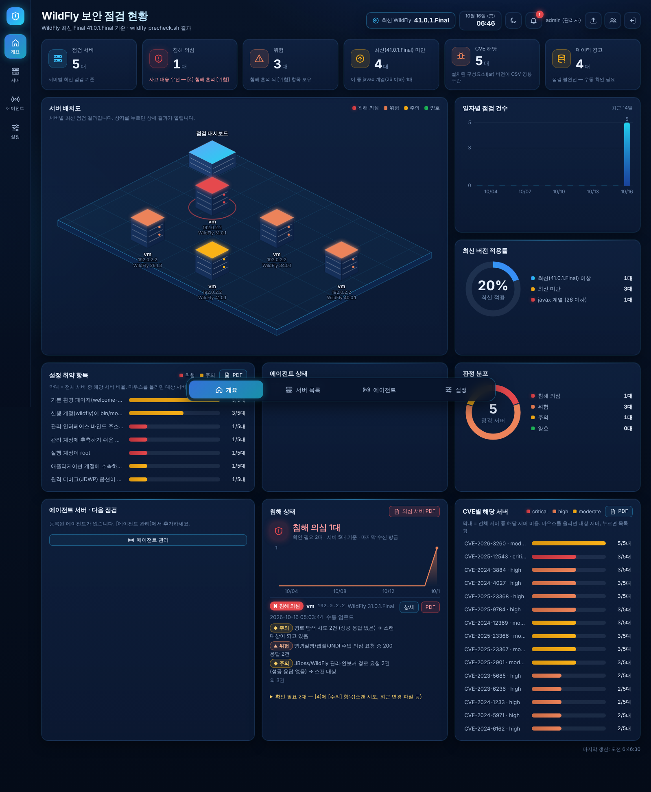

# WildFly 사전점검 대시보드 (wildfly-precheck-dashboard)

**WildFly 서버 자체의 보안 상태**를 점검하고, 그 결과를 로그인한 사용자에게만 한 화면으로 보여 주는 웹 대시보드입니다.
같은 저장소의 `precheck-dashboard/`(Apache 점검 대시보드)와 구성·화면이 같고, **점검 대상만 Apache → WildFly 로 바뀐 것**입니다.

```
 [WAS 서버 A] 에이전트 ─┐   1분마다 "점검할 차례인가요?"  (WAS 서버 → 대시보드 방향 연결만 사용)
 [WAS 서버 B] 에이전트 ─┼─────────────────────────────▶ [WildFly: 대시보드 /wfprecheck] ◀── 브라우저(로그인)
 [WAS 서버 C] 에이전트 ─┘   차례면 wildfly_precheck.sh 실행 → 리포트 전송
```

- 기준 버전: [WildFly 공식 다운로드 페이지](https://www.wildfly.org/downloads/)의 최신 Final = **41.0.1.Final** (2026-10-16 기준)
- 점검 대상: 41.0.1.Final 및 그 **이하** 버전 (실제로 시험한 버전은 아래 "시험 결과" 참고)
- Apache 대시보드와 **같은 WildFly 에 함께 올릴 수 있습니다.** 주소(`/precheck` ↔ `/wfprecheck`), 데이터 폴더, 에이전트 설치 위치가 모두 따로입니다.



## 무엇을 점검하나 (wildfly_precheck.sh)

점검 스크립트는 **읽기만** 합니다. 설정 변경·파일 삭제·재시작을 하지 않습니다.

| 구분 | 점검 내용 |
|---|---|
| [1] 버전·설치 | 실행 중인 WildFly 자동 탐지(여러 개면 각각), 설치 폴더, 버전(최신 Final 미만 여부), 설치 방식(ZIP/RPM/DEB/Galleon), Java, 실행 모드, javax(Java EE 8, WildFly 26 이하) 계열 여부 |
| [2] CVE | 설치 폴더 `modules/` 안의 **실제 구성요소(jar) 버전**을 OSV 취약점 DB 의 영향 구간과 비교 (Undertow, WildFly Core, Elytron, RESTEasy, Remoting/XNIO, EJB 클라이언트, 관리 콘솔 HAL, WildFly 자체) |
| [3] 위험 설정 | 관리 콘솔/관리 API(9990) 외부 노출, 관리 인터페이스 인증 유무, **추측하기 쉬운 관리자 비밀번호**, root 실행, 원격 디버그(JDWP)·JMX 원격 접속, AJP 리스너, 기본 환영 페이지, 디렉터리 목록, JSP 개발 모드, 응답 헤더 버전 노출, 로그 수준, 파일 권한 |
| [4] 침해 흔적 | 접근 로그(경로 탐색·명령 실행·JNDI 주입·JBoss 관리 경로 공격 중 200 응답), 배포된 앱(war/ear, 관리 콘솔로 배포된 `data/content` 포함) 안의 웹쉘 의심 JSP, 최근 바뀐 배포 파일, server.log 의 역직렬화 공격 흔적, 실행 계정의 의심 프로세스·크론·임시 파일, 외부 연결 |

### CVE 판정 방식과 근거

- 근거 데이터: **OSV**(https://osv.dev, Google 운영. GitHub Advisory Database 등을 모은 공개 취약점 DB)의 Maven 데이터
  `https://osv-vulnerabilities.storage.googleapis.com/Maven/all.zip` (2026-10-16 내려받음). 등급은 GitHub Advisory 기준(critical/high/moderate/low).
- 스크립트에 들어 있는 CVE: **89건**(149개 영향 구간). `tools/gen_cve_table.py` 로 언제든 다시 만들 수 있습니다(아래 "CVE 목록 갱신").
- **WildFly 버전 번호가 아니라 구성요소 버전으로 판정**하므로, 패치로 jar 만 바꾼 경우도 반영됩니다.
- 같은 이름의 jar 라도 **groupId 가 다르면(다른 프로젝트) 해당 없음**으로 봅니다.
  예: WildFly 40 이상의 `undertow-servlet-2.0.x.jar` 는 새 프로젝트(`io.undertow.ee`)라, 2019년의 `io.undertow:undertow-servlet` CVE 와 번호가 겹쳐도 해당하지 않습니다.
- 설명은 OSV 원문(영문) 그대로입니다. 한글 번역은 하지 않았습니다(오역 위험).
- **한계**: "그 기능을 실제로 쓰는지"(AJP, OIDC, HTTP/2 등)까지는 판정하지 않습니다. 해당 구성요소가 설치되어 있으면 해당으로 표시합니다.
  또 OSV 에 수정 버전이 아직 없는 CVE(예: CVE-2026-3260)는 최신 41.0.1.Final 에도 [주의]로 나옵니다.

### 쉬운 비밀번호 점검 방식

`mgmt-users.properties` 의 값은 `MD5(아이디:영역:비밀번호)` 입니다(WildFly 40.0.1 의 `add-user.sh` 로 만든 값과 직접 계산한 값이 같음을 확인).
스크립트는 흔한 비밀번호 22개와 "아이디와 같은 비밀번호"로 같은 값을 계산해 **일치하는지만** 봅니다. 리포트에는 계정 이름만 남고 비밀번호는 남지 않습니다.

## 1. 준비물

| 항목 | 확인 방법 | 비고 |
|---|---|---|
| Java 17 이상 | `java -version` | 대시보드 빌드·실행용. 시험은 Java 21 에서 함 |
| Maven 3.8 이상 | `mvn -v` | 빌드할 PC에만 필요 |
| WildFly | 대시보드를 올릴 WildFly | 시험은 **WildFly 41.0.1.Final** 에서 함 |
| 점검 대상 서버 | bash, curl, (권장) unzip, ss | unzip 이 없으면 python3 로 대신 war 안을 봄. 둘 다 없으면 war 안 JSP 점검 생략(데이터 경고 표시) |

## 2. 빌드 (war 파일 만들기)

```bash
cd wildfly-precheck-dashboard
mvn package
```

`BUILD SUCCESS` 가 보이면 `target/wfprecheck.war` 파일이 생깁니다.

## 3. 배포 (대시보드를 WildFly 에 올리기)

1. WildFly 를 **어떤 계정으로 실행하는지** 확인합니다. (아래 예시는 `was`. 서버마다 다르니 꼭 확인)
   ```bash
   ps -eo user,args | grep '[j]boss-modules' | awk '{print $1}'
   ```
2. 리포트와 계정을 저장할 폴더를 만들고, **위에서 확인한 실행 계정**만 쓰게 합니다.
   ```bash
   sudo mkdir -p /data/wfprecheck
   sudo chown was: /data/wfprecheck      # was 자리에 1번에서 확인한 실행 계정
   sudo chmod 700 /data/wfprecheck
   ```
3. WildFly 가 그 폴더를 쓰도록 알려 줍니다. **방법 A 를 권장합니다.**
   - **방법 A (권장, 시작 스크립트와 관계없이 적용)**: WildFly 가 켜진 상태에서 관리 CLI 로 한 번 실행합니다. 값은 WildFly 설정 파일(standalone.xml)에 저장됩니다.
     ```bash
     <WildFly설치경로>/bin/jboss-cli.sh --connect --controller=127.0.0.1:9990 \
       --command='/system-property=wfprecheck.data.dir:add(value=/data/wfprecheck)'
     ```
     (`9990` 은 관리 포트. 포트 오프셋을 쓰면 9990+오프셋. `{"outcome" => "success"}` 가 나오면 성공)
   - 방법 B: `<WildFly설치경로>/bin/standalone.conf` 맨 아래에 `JAVA_OPTS="$JAVA_OPTS -Dwfprecheck.data.dir=/data/wfprecheck"` 추가.
     ⚠️ 회사 자체 시작 스크립트로 띄우는 서버는 이 파일을 읽지 않을 수 있습니다. 그럴 때는 방법 A 를 쓰세요.
   - 아무것도 안 하면 **실행 계정 홈 폴더의 `wfprecheck-dashboard`**(예: `/home/was/wfprecheck-dashboard`)를 씁니다.
4. WildFly 를 다시 시작한 뒤, war 파일을 배포 폴더에 복사합니다.
   ```bash
   cp target/wfprecheck.war <WildFly설치경로>/standalone/deployments/
   ```
5. **데이터 폴더가 제대로 적용됐는지 꼭 확인합니다.** (server.log 위치는 서버 구성에 따라 다름)
   ```bash
   sudo grep "데이터 폴더" <server.log 경로> | tail -1
   ```
   `데이터 폴더: /data/wfprecheck` 가 나와야 합니다. 다른 경로가 나오면 3번 설정이 적용되지 않은 것이고,
   **초기 비밀번호 파일도 그 다른 경로에 있습니다.**
6. 브라우저에서 `http://<서버주소>:8080/wfprecheck/` 로 접속합니다.

## 4. 첫 로그인

1. 처음 시작하면 관리자 계정 `admin` 이 자동으로 만들어집니다.
2. 초기 비밀번호 확인 (경로는 3-5번에서 확인한 데이터 폴더):
   ```bash
   sudo cat /data/wfprecheck/initial-admin-password.txt
   ```
   어느 파일인지 헷갈리면 server.log 에서 확인하는 것이 가장 정확합니다.
   ```bash
   sudo grep "초기 관리자 계정" <server.log 경로> | tail -1     # → "초기 비밀번호는 <경로> 파일에 있습니다"
   ```
   로그인할 때는 한/영 키가 **영문**, Caps Lock 이 꺼진 상태인지, 복사할 때 앞뒤 공백이 따라오지 않았는지 확인하세요.
   5번 연속 틀리면 5분 동안 로그인이 차단됩니다.
   (직접 정하려면 첫 시작 전에 환경변수 `WFPRECHECK_ADMIN_PASSWORD` 설정)
3. 로그인하면 **비밀번호 변경 화면이 먼저 나옵니다.** 바꾸면 위 파일은 자동으로 지워집니다.

비밀번호 규칙: 10자 이상, 영문·숫자·특수문자 중 2가지 이상, 아이디 포함 불가. 5번 틀리면 5분 차단, 30분 동안 사용이 없으면 자동 로그아웃.

## 5. 에이전트 설치 (점검할 WildFly 서버마다 한 번)

1. 대시보드 → 왼쪽 **에이전트** → **에이전트 추가** → 이름(예: `was01`)과 점검 주기(기본 24시간)를 넣고 **등록**
2. 화면에 나오는 명령 2줄을 **점검할 WildFly 서버**에서 실행합니다(각 명령 옆 **복사** 버튼 사용).
   ```bash
   curl -fsSo /tmp/wfprecheck-install.sh http://<대시보드주소>/wfprecheck/agent-api/files/install.sh
   sudo bash /tmp/wfprecheck-install.sh http://<대시보드주소>/wfprecheck was01
   ```
3. 토큰을 물어보면 화면의 **에이전트 토큰**을 붙여 넣고 Enter (입력해도 화면에 안 보이는 것이 정상)
4. `설치 완료` 가 나오면 1~2분 안에 상태가 **온라인**이 되고 첫 점검이 자동으로 시작됩니다.

| 설치되는 것 | 내용 |
|---|---|
| `/opt/wfprecheck-agent/` | 에이전트·점검 스크립트, 보낸 리포트(`sent/`), 전송 대기(`outbox/`) |
| `/etc/wfprecheck-agent.conf` | 대시보드 주소·이름·토큰 (권한 600). `LOG_PATHS`, `RECENT_DAYS`, `RUN_TIMEOUT` 도 여기서 변경 |
| systemd 타이머 `wfprecheck-agent.timer` | 1분마다 실행 (systemd 가 없으면 `/etc/cron.d/wfprecheck-agent`) |

자주 쓰는 명령 (WildFly 서버에서):

```bash
sudo /opt/wfprecheck-agent/wfprecheck-agent.sh test   # 대시보드 연결 확인
sudo /opt/wfprecheck-agent/wfprecheck-agent.sh run    # 지금 바로 점검
sudo bash /tmp/wfprecheck-install.sh --uninstall      # 에이전트 삭제
```

- 한 서버에 WildFly 가 여러 개 떠 있으면 **각각 점검해 리포트를 따로** 보냅니다. 화면에는 `호스트 [설치 폴더 이름]` 으로 구분됩니다.
- "최신 버전 서버는 자동 점검 제외" 규칙은 **그 서버의 인스턴스 중 가장 낮은 버전** 기준입니다(하나라도 최신 미만이면 계속 점검).

## 6. 리포트 직접 넣기 (에이전트를 쓸 수 없는 서버)

1. 점검할 서버에서 실행합니다.
   ```bash
   sudo bash wildfly_precheck.sh                    # 실행 중인 WildFly 자동 탐지
   sudo bash wildfly_precheck.sh -H /opt/wildfly    # WildFly 가 꺼져 있을 때 설치 폴더 지정
   sudo bash wildfly_precheck.sh -l '/var/log/httpd/access_log*'   # 앞단 프록시 로그로 침해 흔적 점검
   ```
2. 만들어진 `/tmp/wildfly_precheck_*.txt` 를 대시보드 오른쪽 위 **리포트 업로드**로 올립니다(관리자만, 파일당 5MB 이하).

## 7. 최신 버전 자동 확인

- 대시보드는 Maven Central 의 WildFly 배포본 버전 목록
  `https://repo1.maven.org/maven2/org/wildfly/wildfly-dist/maven-metadata.xml` 에서 `숫자.숫자.숫자.Final` 중 가장 높은 것을 시작 직후와 12시간마다 읽습니다(Beta/CR 제외).
- 자동 확인이 안 되면 **스크립트 기준값 41.0.1.Final** 을 씁니다. 내부망이면 **설정 → 직접 지정** 으로 넣거나,
  사내 Nexus 미러 주소를 `-Dwfprecheck.latest.url=https://미러/.../maven-metadata.xml` 로 지정하세요.
- **한계**: 최신 버전 "번호"만 자동으로 바뀝니다. 스크립트의 CVE 목록은 자동으로 늘어나지 않습니다 → 아래 "CVE 목록 갱신".

## 8. CVE 목록 갱신 (분기 1회 권장)

```bash
cd wildfly-precheck-dashboard/tools
curl -sSLo all.zip https://osv-vulnerabilities.storage.googleapis.com/Maven/all.zip
mkdir osv && unzip -q all.zip -d osv
python3 gen_cve_table.py osv ../scripts/wildfly_precheck.sh   # 스크립트 안 CVE_DB 블록을 교체
```

그다음 `mvn package` 로 다시 빌드·배포하고, 각 서버에서 `install.sh` 를 다시 실행합니다
(에이전트 화면의 "스크립트" 열이 **다름**이면 이전 스크립트).
최신 Final 기준값을 바꿀 때는 `scripts/wildfly_precheck.sh` 의 `LATEST_FINAL="41.0.1.Final"` 한 줄을 고칩니다.

## 9. 사용자 관리 · 운영 시 주의

- 사용자 관리, 역할(조회 전용/관리자), PDF 3종(침해 흔적·설정 취약·CVE)은 Apache 대시보드와 같습니다.
- **HTTPS 로 운영하세요.** 리포트에 서버 경로·설정·공격 IP 가 들어 있고, 설치 파일은 로그인 없이 받을 수 있어 HTTP 면 바꿔치기될 수 있습니다.
  HTTPS 를 쓰면 `WEB-INF/web.xml` 의 `<secure>true</secure>` 주석을 풀어 주세요.
- 에이전트 토큰은 그 서버의 `/etc/wfprecheck-agent.conf` 에만, 대시보드에는 해시값만 저장됩니다. 유출이 의심되면 **토큰 재발급**.
- 사내망 전용으로 쓰는 것을 전제로 만들었습니다. 인터넷에 직접 노출하지 마세요.

## 시험 결과 (2026-10-16, 이 저장소 작업 환경)

공식 배포본(GitHub 릴리스 zip)을 받아 한 대의 리눅스에서 동시에 띄우고 점검했습니다.
**외부로 포트를 열지 않기 위해 모든 서버는 127.0.0.1 에만 열었고**, "외부 노출" 판정은 꺼진 34.0.1 의 설정 파일만 바꿔서 확인했습니다.

| 버전 | 일부러 만든 조건 | 결과 (위험/주의) | 확인한 것 |
|---|---|---|---|
| 41.0.1.Final | 없음 (기본), wildfly 계정 실행, 대시보드도 여기에 배포 | 0 / 6 | 해당 CVE 1건(CVE-2026-3260, OSV 수정 버전 없음) |
| 40.0.1.Final | root 실행, admin/admin 관리 계정, `--debug 127.0.0.1:8787` | 2 / 5 | 쉬운 비밀번호·root 실행 [위험], 원격 디버그 [주의] |
| 34.0.1.Final | **꺼진 상태**, 설정 파일의 관리 인터페이스 기본값을 0.0.0.0 으로, 앱 계정 appuser/changeit | 6 / 9 | 설정 기준 외부 노출 [위험], 앱 계정 쉬운 비밀번호 [주의] |
| 31.0.1.Final | 접근 로그 켬 + 로컬에서 공격 형태 요청, **실행 코드 없이 주석에만 웹쉘 문자열을 넣은 시험용 JSP** 배포 | 13 / 14 | 침해 의심 판정, war 안 JSP 와 `data/content` 사본 모두 탐지 |
| 26.1.3.Final | 없음 (기본, javax 계열) | 17 / 15 | 해당 CVE 27건, javax 계열 표시 |

- 에이전트 전체 흐름(대시보드에서 등록 → 설치 파일 받기 → 설치 → 점검 → 리포트 4개 자동 전송)도 실제로 확인했습니다.
- 위 리포트 원본은 `src/test/resources/` 에 있고, 단위 테스트 31개가 이것으로 해석기·PDF 를 검사합니다.
- 시험하지 **못한** 것: 도메인 모드(domain.sh), RPM/DEB/컨테이너 설치본, WildFly 23 이하, systemd 타이머 동작(작업 환경에 systemd·cron 이 없어 `poll` 을 손으로 실행),
  Maven Central 버전 목록 자동 확인(작업 환경의 네트워크 정책으로 목록 파일이 막혀 기준값 41.0.1.Final 로 동작함을 확인).

화면: [서버 목록](docs/servers.png) · [침해 의심 서버 상세](docs/detail-compromise.png) · [CVE 판정](docs/detail-cves.png) · [에이전트](docs/agents.png) · [밝은 화면](docs/overview-light.png)

## 개발자용 메모

```
scripts/wildfly_precheck.sh   점검 스크립트 (CVE_DB 블록은 tools/gen_cve_table.py 로 생성)
scripts/wfprecheck-agent.sh   에이전트, scripts/install.sh 설치 → 빌드 시 WAR 의 WEB-INF/classes/agent/ 에 들어감
tools/gen_cve_table.py        OSV Maven 데이터 → CVE 표
src/main/java/com/webwas/wfprecheck/
  ReportParser.java  리포트 → Report (스크립트 출력 문구에 맞춘 정규식, Maven 식 버전 비교)
  LatestVersion.java WildFly 최신 Final 자동 확인/직접 지정
  그 밖의 구조는 precheck-dashboard(Apache)와 같음
src/test/resources/  실제 WildFly 26.1.3 / 31.0.1 / 34.0.1 / 40.0.1 / 41.0.1 점검 리포트
```

테스트: `mvn test`
